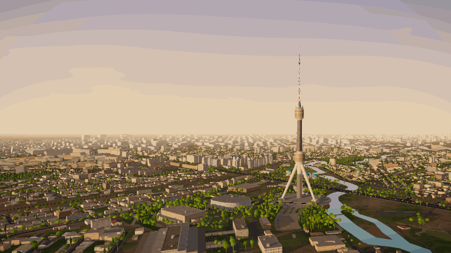
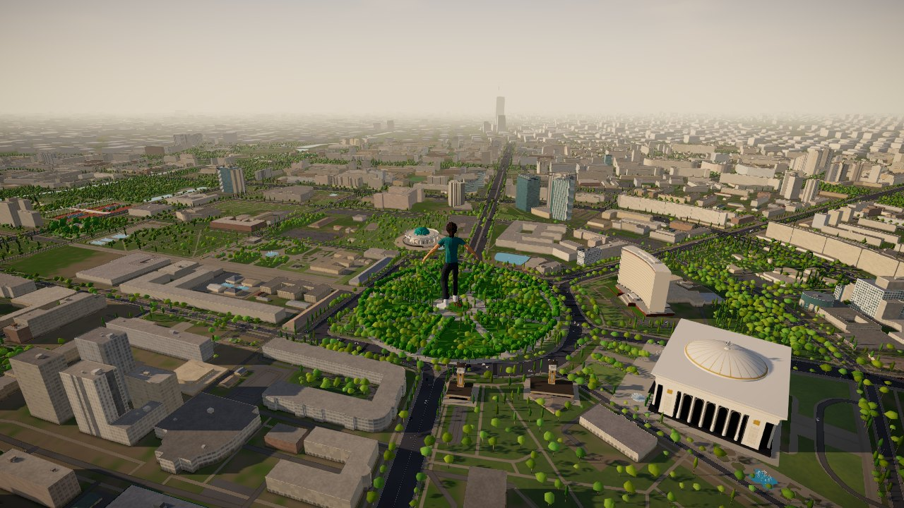
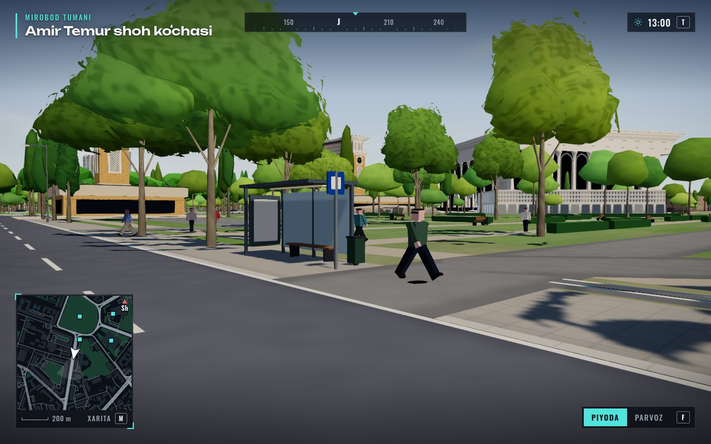
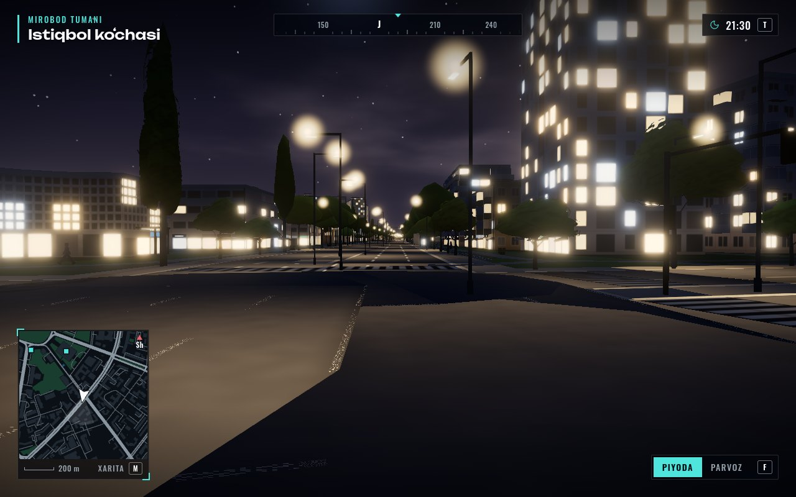
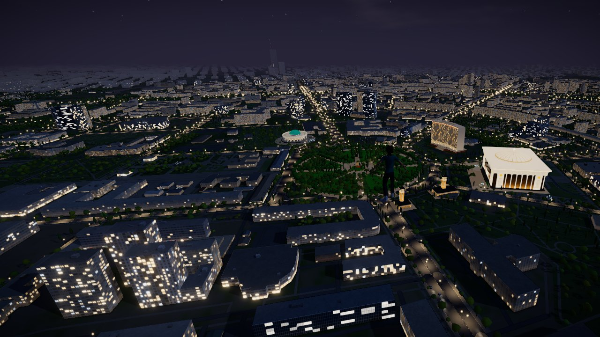
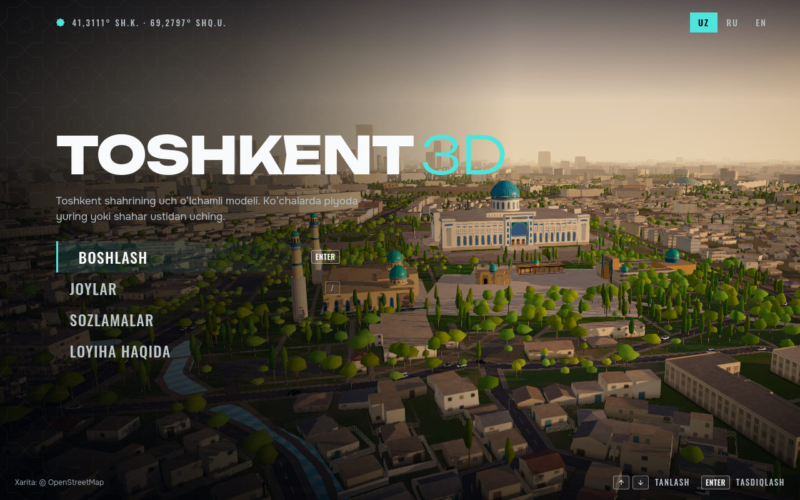
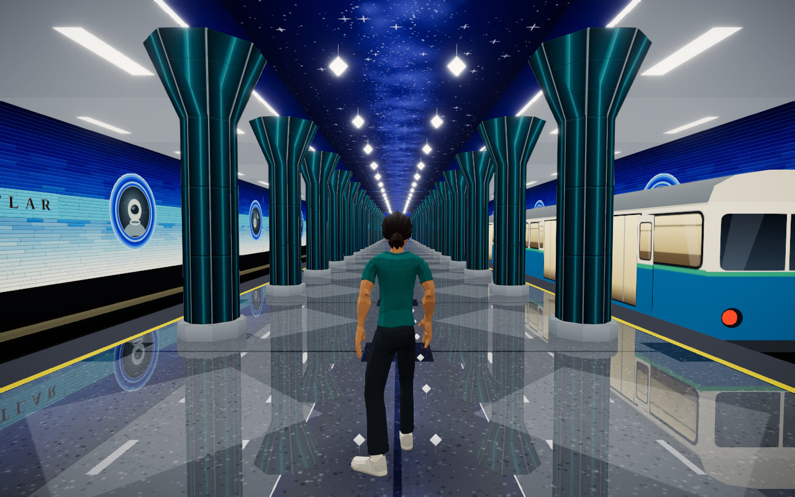
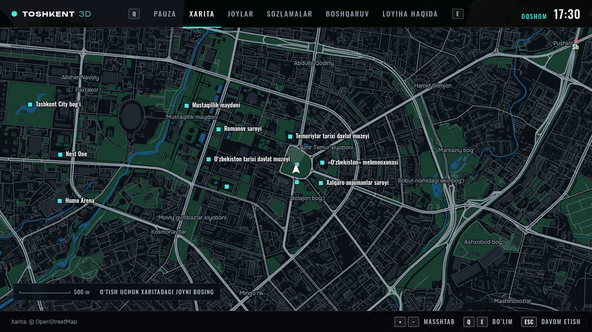
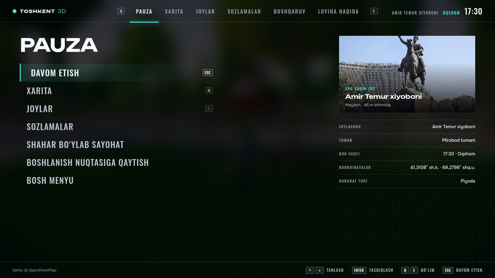
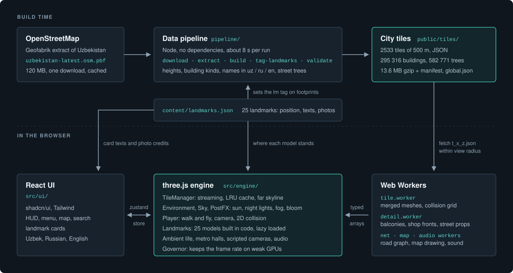

<p align="center">
  <b>English</b> · <a href="README.uz.md">Oʻzbekcha</a> · <a href="README.ru.md">Русский</a>
</p>

<h1 align="center">Toshkent 3D</h1>

<p align="center">
  The whole city of Tashkent as a 3D model in the browser, built from OpenStreetMap data.<br>
  Walk the streets or fly over the city.
</p>

<p align="center">
  <a href="https://tashkent-3d.ulussolutions.uz/"><b>Open the live demo</b></a>
</p>

<p align="center">
  <a href="https://tashkent-3d.ulussolutions.uz/"></a>
  <a href="LICENSE"></a>
  <a href="#data-and-licenses"></a>
</p>

<p align="center">
  <a href="https://tashkent-3d.ulussolutions.uz/">
    
  </a>
</p>

## What it is

Toshkent 3D is a web page that draws Tashkent in three dimensions. Every building footprint,
street, canal and park comes from OpenStreetMap. Twenty-five well-known places are modelled by
hand in code. You move through the city in third person, on foot or in the air, the way you
would in an open-world game.

There is no install and no account. The demo needs a browser with WebGL 2. A desktop or laptop
is the main target. Phones work with on-screen controls.

The project exists to let people look around Tashkent and learn its places. It is not a game:
there are no goals and no score.

## Screenshots

<table>
  <tr>
    <td width="50%"></td>
    <td width="50%"></td>
  </tr>
  <tr>
    <td align="center">Fly mode over Amir Temur Square.</td>
    <td align="center">Walk mode with the compass, clock and minimap.</td>
  </tr>
  <tr>
    <td></td>
    <td></td>
  </tr>
  <tr>
    <td align="center">Night: lit windows and street lamps.</td>
    <td align="center">The centre at night.</td>
  </tr>
  <tr>
    <td></td>
    <td></td>
  </tr>
  <tr>
    <td align="center">The Hazrati Imam complex behind the start screen.</td>
    <td align="center">A metro station hall.</td>
  </tr>
  <tr>
    <td></td>
    <td></td>
  </tr>
  <tr>
    <td align="center">City map. Click a point to move there.</td>
    <td align="center">Menu (the interface is shown here in Uzbek).</td>
  </tr>
</table>

## Features

**The city**

- The whole city inside its administrative boundary: 609.6 km², 2533 tiles of 500 m.
- 295 316 buildings extruded from OpenStreetMap footprints. Heights come from OSM tags where
  they exist and from documented rules where they do not (see [Limits](#limits)).
- 8665 km of roads with lane markings, kerbs, sidewalks and crosswalks. 1741 km of footpaths.
- 582 771 trees: mapped trees, street rows along avenues, and parks.
- Canals, ponds, parks and squares. Fountains run on the squares.
- Ten facade styles drawn in a shader: mahalla houses, Soviet panel blocks, glass towers,
  shop fronts and others. Windows are not textures and not geometry.
- Street names in Uzbek, Russian and English. Where OSM has no translation, the name is
  transliterated and the generic word translated (`koʻchasi` → `улица` / `Street`).

**Landmarks**

- 25 hand-modelled places, among them the TV tower, Hazrati Imam, Chorsu Bazaar, Kukeldash
  Madrasah, Minor Mosque, Hotel Uzbekistan, the Navoi Theatre, Amir Temur Square and Nest One.
  Full list: [`content/landmarks.json`](content/landmarks.json).
- Each has a card with a short text, facts and photos from Wikimedia Commons. Author and
  license are shown next to every photo.
- A city tour flies the camera from one landmark to the next.

**Life**

- Cars, minivans and buses drive on the road network. Pedestrians walk on sidewalks and paths.
- Birds fly over parks and squares.
- Sound is synthesised in the browser: traffic, birds, crickets at night, wind, footsteps.
  The repository contains no audio files.

**Day and night**

- A full day cycle with sun, moon, stars and clouds. Set the hour yourself or let time run.
- At night windows, street lamps, shop signs and headlights light up.

**Metro**

- All 49 station entrances are in the city. Press <kbd>G</kbd> at one to go down to the platform.
- Three halls are modelled after the real stations: Kosmonavtlar, Alisher Navoiy and
  Mustaqillik maydoni. The other stations reuse these three halls in different colours.
- Trains arrive, open their doors and leave.

**Interface**

- Uzbek (Latin), Russian and English.
- City map, place search, time-of-day control, photo mode.
- Keyboard and mouse. Touch controls on phones. A gamepad works in the menus.

**Performance**

- Written for integrated graphics. The development target was an Intel UHD 730.
- Three quality presets. An automatic governor lowers the render resolution first when the
  frame rate drops.
- A full view is 100 to 270 draw calls: one merged mesh per tile and material.
- Tiles load around the camera and unload behind it. The far city is drawn as instanced boxes.
- City data is 13.6 MB gzipped in total. Only the tiles near you are downloaded.

## Controls

| Key | On foot | In the air |
|---|---|---|
| <kbd>W</kbd> <kbd>A</kbd> <kbd>S</kbd> <kbd>D</kbd> | Move | Fly |
| Mouse | Look around | Look around |
| <kbd>Shift</kbd> | Run | Boost |
| <kbd>Space</kbd> | Jump | Up (also <kbd>E</kbd>) |
| <kbd>C</kbd> / <kbd>Q</kbd> / <kbd>Ctrl</kbd> | | Down |
| <kbd>F</kbd> | Take off | Land |
| <kbd>V</kbd> | First-person view | Camera without the character |
| Mouse wheel | Camera distance | Camera distance |
| <kbd>E</kbd> | Open the card of the nearby landmark | |
| <kbd>G</kbd> | Enter or leave the metro | |

| Key | Anywhere |
|---|---|
| <kbd>M</kbd> | Map |
| <kbd>/</kbd> | Places and search |
| <kbd>T</kbd> | Time of day |
| <kbd>P</kbd> | Photo mode (hides the interface) |
| <kbd>N</kbd> | Sound on or off |
| <kbd>Esc</kbd> | Menu |

## How it works

<p align="center">
  
</p>

1. **Data pipeline** ([`pipeline/`](pipeline/README.md)). A Node script downloads the Geofabrik
   extract of Uzbekistan (120 MB) and reads the PBF file with its own small parser. It keeps what
   lies inside Tashkent, assigns heights and building kinds, cleans and translates names, places
   street trees, and writes one JSON file per 500 m tile. There are no npm dependencies. A full
   run takes about 8 seconds once the download is cached.
2. **Tiles** (`public/tiles/`). Coordinates are integers in decimetres relative to the tile
   corner. The origin of the local grid is Amir Temur Square. The format is described in
   [`docs/BRIEF.md`](docs/BRIEF.md) under "City data contract".
3. **Web workers**. A worker fetches each tile, triangulates footprints with earcut, and builds
   one merged mesh per material together with a collision grid. Other workers build street
   detail, the road graph for traffic, the map and the sound clips.
4. **Engine** ([`src/engine/`](docs/ENGINE.md)). Plain three.js classes, no react-three-fiber.
   The engine streams tiles around the camera, draws the sky and the lighting, moves the player
   and runs the ambient systems. Walking uses a 2D collision test against footprints. There is
   no physics library.
5. **Interface** (`src/ui/`). React with shadcn/ui and Tailwind. The UI and the engine talk only
   through one zustand store.

Hand-made landmark models are separate chunks. The browser downloads one when the camera comes
near it.

## Run locally

Requirements: Node.js 22 or newer and npm. The pipeline needs about 1.1 GB of free memory.

```bash
git clone https://github.com/diy0r/tashkent-3d.git
cd tashkent-3d
npm install

# Build the city tiles (downloads 120 MB of OpenStreetMap data once)
npm run build-data

# Start the dev server at http://127.0.0.1:5190
npm run dev
```

The generated tiles (about 50 MB) are not in the repository. If you skip `npm run build-data`,
the engine falls back to a small synthetic city in `public/tiles-dev/`, which is enough to work
on the interface.

Production build and server:

```bash
npm run build:prod   # vite build, then gzip and brotli copies of text assets
npm run serve        # static server on port 8090 (PORT and HOST change it)
```

`server/serve.mjs` has no dependencies. It serves `dist/` with the precompressed files and
cache headers. Any static host works as well.

Other commands:

| Command | What it does |
|---|---|
| `npm run typecheck` | TypeScript check of the app |
| `npm run build` | Type check and build |
| `npm run tag-landmarks` | Re-link landmarks to footprints after editing `content/landmarks.json` |
| `npm run fixture` | Regenerate the synthetic tiles in `public/tiles-dev/` |
| `cd pipeline && npm run validate` | Check the tiles against the data contract |

Useful URL parameters: `?q=low|medium|high` fixes the quality, `?t=21.5` sets the start hour,
`?lang=uz|ru|en` sets the language, `?perf=1` shows the profiler, `?data=dev` forces the
synthetic tiles.

## Project structure

```
content/landmarks.json   landmark positions, texts in three languages, photo credits
pipeline/                OpenStreetMap download and processing (Node, own package.json)
public/
  tiles/                 generated city tiles (not in git)
  tiles-dev/             small synthetic tile set for development
  places/                landmark photos
  models/                player character
  fonts/                 interface fonts
src/
  engine/                three.js engine
    world/               tile streaming, tile worker, materials, trees, skyline, collision
    env/                 sun, sky, fog, postprocessing
    player/              walk and fly controller, camera, character, input
    landmarks/           one file per landmark model
    ambient/             traffic, pedestrians, birds, fountains
    detail/, props/      balconies, shop fronts, benches, bus stops
    metro/               station halls and trains
    cinematic/           start-screen camera, city tour, photo mode
    audio/               synthesised sound
    perf/                profiler, render gate, frame-rate governor
  ui/                    React interface: HUD, menu, map, landmark cards
  state/store.ts         zustand store shared by the engine and the UI
  i18n/                  uz.json, ru.json, en.json
server/serve.mjs         production static server
tools/                   screenshot, benchmark and build helpers
docs/                    engine notes, design system, research, credits
```

## Adding a landmark

1. Add an entry to [`content/landmarks.json`](content/landmarks.json): `id`, `category`, `lat`,
   `lon`, `rotationDeg`, the OSM ids of its footprints (`osmIds`, for example `"way/325125766"`),
   and `name`, `short`, `text` and `facts` in Uzbek, Russian and English.
2. Put photos in `public/places/<id>/`. Use only photos with a free license. Record the file,
   source, author and license in the entry and in [`docs/CREDITS.md`](docs/CREDITS.md). Run
   `python3 tools/thumbs.py` to make the thumbnail (needs Pillow).
3. Create `src/engine/landmarks/<id>.ts`. The file name must equal the id. Export an object with
   that `id` and a `build()` function that returns a `THREE.Group`: metres, y up, origin on the
   ground at the landmark's coordinates, front facing north. It is registered automatically.
4. Run `npm run tag-landmarks`. This marks the OSM footprints so the engine hides the extruded
   boxes and places your model instead.
5. Look at the model alone at `http://127.0.0.1:5190/landmark-preview.html?id=<id>`, then in the
   city.

Keep models cheap: merged geometry, few materials, no textures above 1024 px. More detail is in
[`docs/ENGINE.md`](docs/ENGINE.md) and [`CONTRIBUTING.md`](CONTRIBUTING.md).

## Limits

- Only 0.9 % of buildings in OSM have a `height` tag and 8.4 % have `building:levels`. The other
  heights are estimates from the building kind, the footprint and the neighbours. Some towers are
  the wrong height.
- Some old-city mahallas are mapped incompletely in OSM, so some blocks look sparse.
- The ground is flat. Bridges are drawn at ground level.
- Cars do not obey traffic lights or give way. Some one-way streets are driven in both directions.
- Performance has not been benchmarked on a wide range of devices. If the city is slow, lower
  the quality in the settings or open it with `?q=low`.

The best way to fix a wrong building or street is to fix it in
[OpenStreetMap](https://www.openstreetmap.org/). The next data build picks it up.

## Data and licenses

| What | License | Source |
|---|---|---|
| Source code | [MIT](LICENSE) | this repository |
| City data: buildings, roads, water, green areas, names | [ODbL 1.0](https://opendatacommons.org/licenses/odbl/1-0/) | © [OpenStreetMap](https://www.openstreetmap.org/copyright) contributors, extract by [Geofabrik](https://download.geofabrik.de/asia/uzbekistan.html) |
| Landmark photos in `public/places/` | CC BY-SA 4.0, CC BY 4.0 or CC0, per photo | Wikimedia Commons. Every file is listed with author and license in [`docs/CREDITS.md`](docs/CREDITS.md) |
| Player character `public/models/character.glb` | CC0 1.0 | [Quaternius](https://quaternius.com) |
| Fonts: Unbounded, Oswald, Onest | SIL Open Font License 1.1 | Google Fonts |
| Landmark texts in `content/landmarks.json` | MIT, like the code | written for this project |

The MIT license covers the code only. The tiles produced by the pipeline are a database derived
from OpenStreetMap and stay under the ODbL. If you publish them or something built from them,
credit "© OpenStreetMap contributors" and keep the derived data open under the same license. The
app shows this credit on the start screen and in the menu.

Photos under CC BY and CC BY-SA must keep their author and license when reused.

## Acknowledgements

- [OpenStreetMap](https://www.openstreetmap.org/) contributors, who mapped Tashkent building by
  building, and [Geofabrik](https://www.geofabrik.de/) for the daily extracts.
- [three.js](https://threejs.org/), [postprocessing](https://github.com/pmndrs/postprocessing),
  [earcut](https://github.com/mapbox/earcut), [zustand](https://github.com/pmndrs/zustand),
  [React](https://react.dev/), [shadcn/ui](https://ui.shadcn.com/),
  [Tailwind CSS](https://tailwindcss.com/), [Vite](https://vite.dev/) and
  [Lucide](https://lucide.dev/).
- The photographers on Wikimedia Commons whose pictures are on the landmark cards.
- [Quaternius](https://quaternius.com) for the CC0 character model.

## How it was built

The code, the landmark models and the texts were written by AI coding agents (Claude, by
Anthropic). The author set the goals, directed the work and reviewed the results. Facts on the
landmark cards were checked against Wikipedia and Wikidata, but mistakes are possible. If you
find one, please open an issue.

## Contributing

Bug reports, corrections and new landmarks are welcome. See [`CONTRIBUTING.md`](CONTRIBUTING.md).
