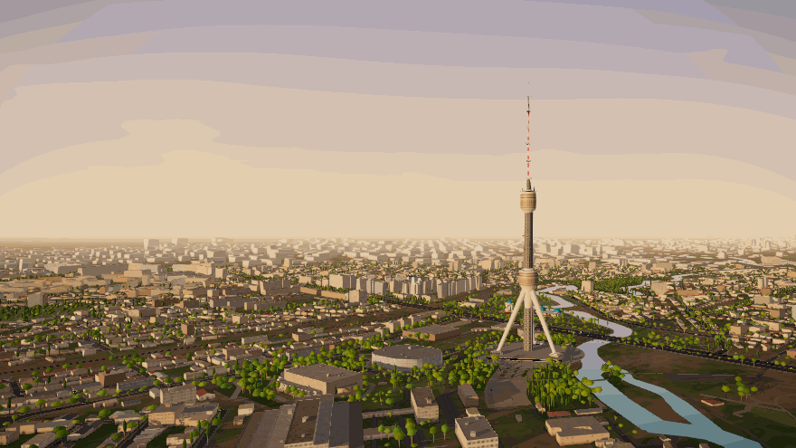
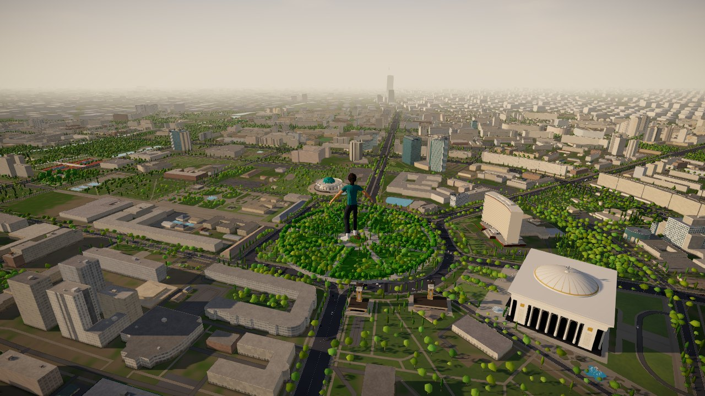
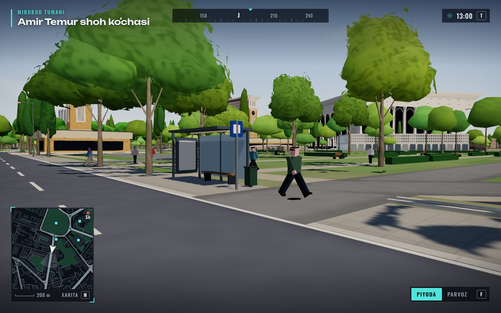
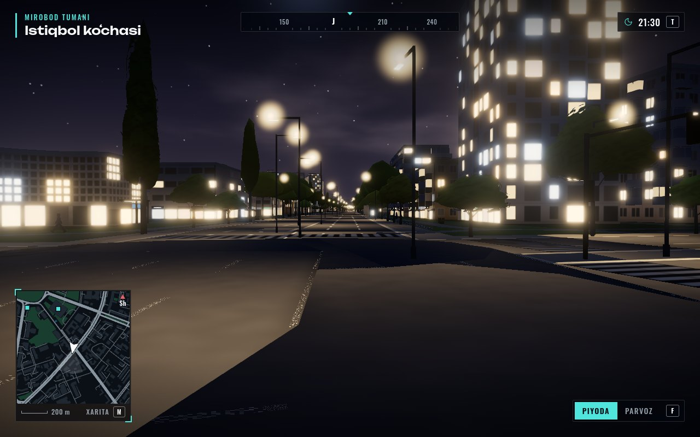
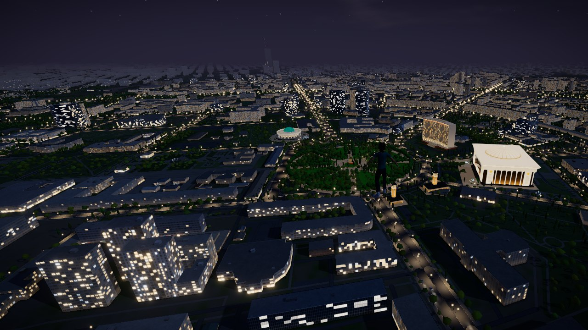
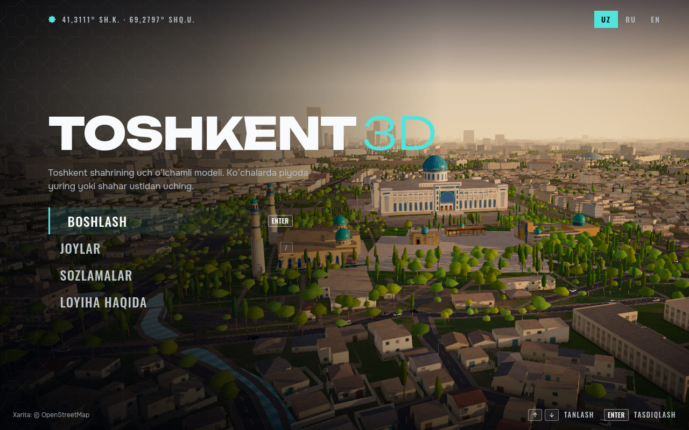
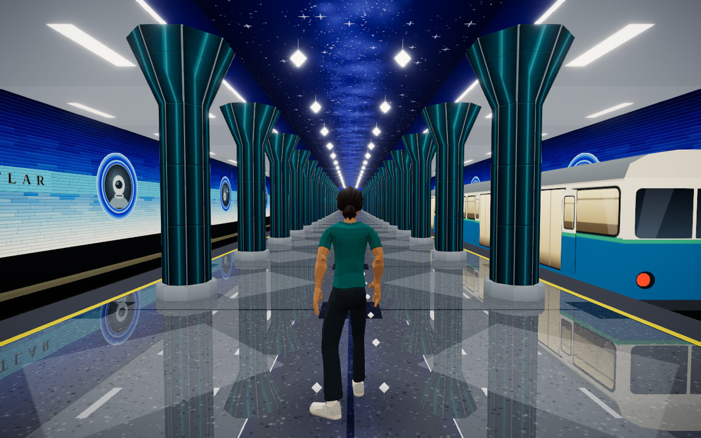
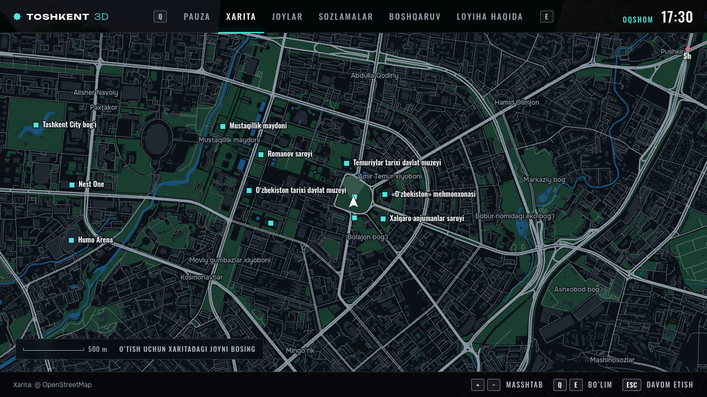
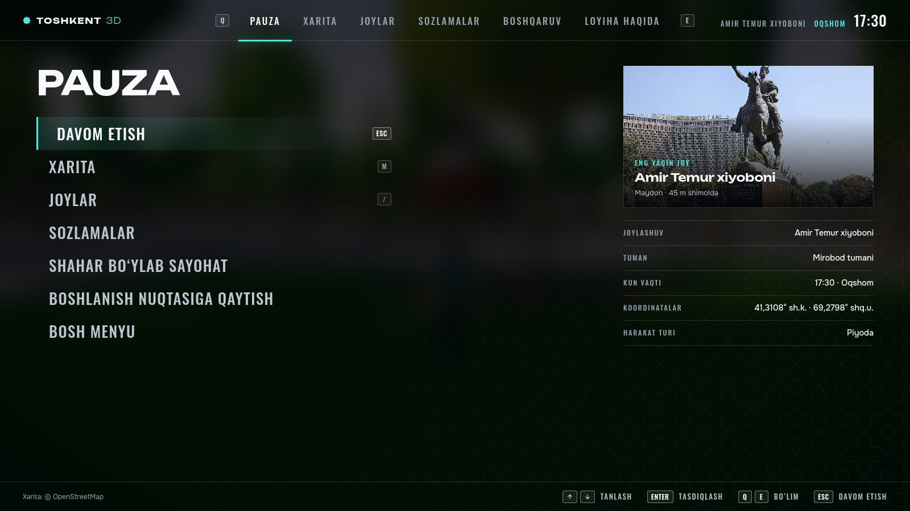
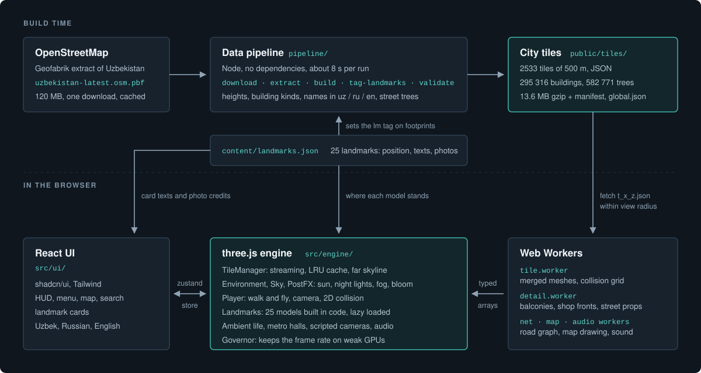

<p align="center">
  <a href="README.md">English</a> · <a href="README.uz.md">Oʻzbekcha</a> · <b>Русский</b>
</p>

<h1 align="center">Toshkent 3D</h1>

<p align="center">
  Весь Ташкент в виде трёхмерной модели в браузере, построенной по данным OpenStreetMap.<br>
  Ходите по улицам или летайте над городом.
</p>

<p align="center">
  <a href="https://tashkent-3d.ulussolutions.uz/"><b>Открыть демо</b></a>
</p>

<p align="center">
  <a href="https://tashkent-3d.ulussolutions.uz/"></a>
  <a href="LICENSE"></a>
  <a href="#данные-и-лицензии"></a>
</p>

<p align="center">
  <a href="https://tashkent-3d.ulussolutions.uz/">
    
  </a>
</p>

## Что это

Toshkent 3D — веб-страница, которая рисует Ташкент в трёх измерениях. Контуры всех зданий,
улицы, каналы и парки взяты из OpenStreetMap. Двадцать пять известных мест смоделированы вручную
в коде. По городу вы перемещаетесь от третьего лица, пешком или по воздуху, как в игре с
открытым миром.

Ничего не нужно устанавливать, регистрация не нужна. Демо требует браузер с WebGL 2. Проект
рассчитан прежде всего на компьютер или ноутбук. На телефоне работает экранное управление.

Проект нужен, чтобы осмотреть Ташкент и узнать его места. Это не игра: здесь нет целей и нет
очков.

## Скриншоты

<table>
  <tr>
    <td width="50%"></td>
    <td width="50%"></td>
  </tr>
  <tr>
    <td align="center">Режим полёта над сквером Амира Темура.</td>
    <td align="center">Режим ходьбы: компас, часы и мини-карта.</td>
  </tr>
  <tr>
    <td></td>
    <td></td>
  </tr>
  <tr>
    <td align="center">Ночь: окна и уличные фонари.</td>
    <td align="center">Центр города ночью.</td>
  </tr>
  <tr>
    <td></td>
    <td></td>
  </tr>
  <tr>
    <td align="center">Комплекс Хазрати Имам за стартовым экраном.</td>
    <td align="center">Зал станции метро.</td>
  </tr>
  <tr>
    <td></td>
    <td></td>
  </tr>
  <tr>
    <td align="center">Карта города. Щёлкните по точке, чтобы переместиться туда.</td>
    <td align="center">Меню (интерфейс здесь на узбекском).</td>
  </tr>
</table>

## Возможности

**Город**

- Весь город в административных границах: 609,6 км², 2533 тайла по 500 м.
- 295 316 зданий, выдавленных из контуров OpenStreetMap. Высота берётся из тегов OSM, где они
  есть, а где их нет — из описанных правил (см. [Ограничения](#ограничения)).
- 8665 км дорог с разметкой, бордюрами, тротуарами и пешеходными переходами. 1741 км пешеходных
  дорожек.
- 582 771 дерево: отмеченные на карте деревья, ряды вдоль проспектов и парки.
- Каналы, пруды, парки и площади. На площадях работают фонтаны.
- Десять стилей фасадов, нарисованных шейдером: дома махалли, советские панельные дома,
  стеклянные башни, витрины и другие. Окна — это не текстуры и не геометрия.
- Названия улиц на узбекском, русском и английском. Если в OSM перевода нет, название
  транслитерируется, а родовое слово переводится (`koʻchasi` → `улица` / `Street`).

**Достопримечательности**

- 25 мест смоделированы вручную, среди них телебашня, Хазрати Имам, базар Чорсу, медресе
  Кукельдаш, мечеть Минор, гостиница «Узбекистан», театр имени Навои, сквер Амира Темура и
  Nest One. Полный список: [`content/landmarks.json`](content/landmarks.json).
- У каждого места есть карточка с коротким текстом, фактами и фотографиями с Викисклада. Рядом
  с каждой фотографией указаны автор и лицензия.
- В обзорном туре камера перелетает от одной достопримечательности к другой.

**Жизнь города**

- По дорожной сети ездят легковые машины, микроавтобусы и автобусы. По тротуарам и дорожкам
  ходят пешеходы.
- Над парками и площадями летают птицы.
- Звук синтезируется в браузере: уличное движение, птицы, сверчки ночью, ветер, шаги. В
  репозитории нет ни одного аудиофайла.

**День и ночь**

- Полный суточный цикл: солнце, луна, звёзды и облака. Час можно задать вручную или запустить
  ход времени.
- Ночью загораются окна, уличные фонари, вывески и фары.

**Метро**

- В городе есть входы всех 49 станций. Нажмите <kbd>G</kbd> у входа, чтобы спуститься на
  платформу.
- Три зала сделаны по настоящим станциям: «Космонавтлар», «Алишер Навои» и «Мустакиллик
  майдони». Остальные станции используют эти три зала в других цветах.
- Поезда прибывают, открывают двери и уезжают.

**Интерфейс**

- Узбекский (латиница), русский и английский.
- Карта города, поиск мест, управление временем суток, фоторежим.
- Клавиатура и мышь. На телефонах — экранное управление. В меню работает геймпад.

**Производительность**

- Рассчитано на встроенную графику. Целевой машиной при разработке был Intel UHD 730.
- Три уровня качества. Когда частота кадров падает, автоматический регулятор сначала снижает
  разрешение рендера.
- Полный вид — от 100 до 270 вызовов отрисовки: одна объединённая сетка на тайл и материал.
- Тайлы загружаются вокруг камеры и выгружаются позади неё. Дальний город рисуется
  инстансированными коробками.
- Данные города занимают 13,6 МБ в gzip. Скачиваются только тайлы рядом с вами.

## Управление

| Клавиша | Пешком | В полёте |
|---|---|---|
| <kbd>W</kbd> <kbd>A</kbd> <kbd>S</kbd> <kbd>D</kbd> | Движение | Полёт |
| Мышь | Осмотреться | Осмотреться |
| <kbd>Shift</kbd> | Бег | Ускорение |
| <kbd>Space</kbd> | Прыжок | Вверх (также <kbd>E</kbd>) |
| <kbd>C</kbd> / <kbd>Q</kbd> / <kbd>Ctrl</kbd> | | Вниз |
| <kbd>F</kbd> | Взлететь | Приземлиться |
| <kbd>V</kbd> | Вид от первого лица | Камера без персонажа |
| Колесо мыши | Расстояние камеры | Расстояние камеры |
| <kbd>E</kbd> | Открыть карточку ближайшего места | |
| <kbd>G</kbd> | Войти в метро или выйти из него | |

| Клавиша | В любом режиме |
|---|---|
| <kbd>M</kbd> | Карта |
| <kbd>/</kbd> | Места и поиск |
| <kbd>T</kbd> | Время суток |
| <kbd>P</kbd> | Фоторежим (скрывает интерфейс) |
| <kbd>N</kbd> | Включить или выключить звук |
| <kbd>Esc</kbd> | Меню |

## Как это устроено

<p align="center">
  
</p>

1. **Конвейер данных** ([`pipeline/`](pipeline/README.md)). Скрипт на Node скачивает выгрузку
   Узбекистана с Geofabrik (120 МБ) и читает PBF-файл собственным небольшим парсером. Он
   оставляет то, что лежит внутри Ташкента, назначает высоты и типы зданий, чистит и переводит
   названия, расставляет деревья вдоль улиц и записывает по одному JSON-файлу на тайл 500 м.
   Зависимостей из npm нет. Когда выгрузка уже скачана, полный прогон занимает около 8 секунд.
2. **Тайлы** (`public/tiles/`). Координаты — целые числа в дециметрах от угла тайла. Начало
   местной сетки — сквер Амира Темура. Формат описан в [`docs/BRIEF.md`](docs/BRIEF.md), раздел
   «City data contract».
3. **Веб-воркеры**. Воркер загружает каждый тайл, триангулирует контуры библиотекой earcut и
   собирает по одной объединённой сетке на материал вместе с сеткой столкновений. Другие
   воркеры строят уличные детали, дорожный граф для транспорта, карту и звуковые клипы.
4. **Движок** ([`src/engine/`](docs/ENGINE.md)). Обычные классы three.js, без react-three-fiber.
   Движок подгружает тайлы вокруг камеры, рисует небо и освещение, двигает игрока и запускает
   системы окружения. Ходьба использует двумерную проверку столкновений с контурами зданий.
   Физической библиотеки нет.
5. **Интерфейс** (`src/ui/`). React, shadcn/ui и Tailwind. Интерфейс и движок общаются только
   через одно хранилище zustand.

Ручные модели достопримечательностей — отдельные чанки. Браузер скачивает модель, когда камера
оказывается рядом.

## Запуск на своём компьютере

Нужны Node.js 22 или новее и npm. Конвейеру данных нужно около 1,1 ГБ свободной памяти.

```bash
git clone https://github.com/diy0r/tashkent-3d.git
cd tashkent-3d
npm install

# Собрать тайлы города (один раз скачивает 120 МБ данных OpenStreetMap)
npm run build-data

# Запустить dev-сервер на http://127.0.0.1:5190
npm run dev
```

Сгенерированных тайлов (около 50 МБ) в репозитории нет. Если пропустить `npm run build-data`,
движок возьмёт небольшой синтетический город из `public/tiles-dev/`. Для работы над
интерфейсом этого достаточно.

Продакшен-сборка и сервер:

```bash
npm run build:prod   # vite build, затем копии текстовых файлов в gzip и brotli
npm run serve        # статический сервер на порту 8090 (меняется через PORT и HOST)
```

У `server/serve.mjs` нет зависимостей. Он отдаёт `dist/` с заранее сжатыми файлами и
заголовками кеширования. Подойдёт и любой статический хостинг.

Другие команды:

| Команда | Что делает |
|---|---|
| `npm run typecheck` | Проверка типов TypeScript |
| `npm run build` | Проверка типов и сборка |
| `npm run tag-landmarks` | Заново привязать достопримечательности к контурам после правки `content/landmarks.json` |
| `npm run fixture` | Пересоздать синтетические тайлы в `public/tiles-dev/` |
| `cd pipeline && npm run validate` | Проверить тайлы на соответствие контракту данных |

Полезные параметры URL: `?q=low|medium|high` фиксирует качество, `?t=21.5` задаёт начальный
час, `?lang=uz|ru|en` задаёт язык, `?perf=1` показывает профайлер, `?data=dev` включает
синтетические тайлы.

## Структура проекта

```
content/landmarks.json   координаты мест, тексты на трёх языках, авторы фотографий
pipeline/                загрузка и обработка OpenStreetMap (Node, свой package.json)
public/
  tiles/                 сгенерированные тайлы города (нет в git)
  tiles-dev/             небольшой синтетический набор тайлов для разработки
  places/                фотографии достопримечательностей
  models/                персонаж игрока
  fonts/                 шрифты интерфейса
src/
  engine/                движок на three.js
    world/               подгрузка тайлов, воркер тайлов, материалы, деревья, силуэт города, столкновения
    env/                 солнце, небо, туман, постобработка
    player/              ходьба и полёт, камера, персонаж, ввод
    landmarks/           по одному файлу на модель достопримечательности
    ambient/             транспорт, пешеходы, птицы, фонтаны
    detail/, props/      балконы, витрины, скамейки, остановки
    metro/               залы станций и поезда
    cinematic/           камера стартового экрана, обзорный тур, фоторежим
    audio/               синтезированный звук
    perf/                профайлер, отложенный показ объектов, регулятор частоты кадров
  ui/                    интерфейс на React: HUD, меню, карта, карточки мест
  state/store.ts         хранилище zustand, общее для движка и интерфейса
  i18n/                  uz.json, ru.json, en.json
server/serve.mjs         статический сервер для продакшена
tools/                   скрипты для скриншотов, замеров и сборки
docs/                    заметки о движке, дизайн-система, исследования, список источников
```

## Как добавить достопримечательность

1. Добавьте запись в [`content/landmarks.json`](content/landmarks.json): `id`, `category`,
   `lat`, `lon`, `rotationDeg`, идентификаторы контуров в OSM (`osmIds`, например
   `"way/325125766"`), а также `name`, `short`, `text` и `facts` на узбекском, русском и
   английском.
2. Положите фотографии в `public/places/<id>/`. Только со свободной лицензией. Запишите файл,
   источник, автора и лицензию в запись и в [`docs/CREDITS.md`](docs/CREDITS.md). Запустите
   `python3 tools/thumbs.py`, чтобы сделать миниатюру (нужен Pillow).
3. Создайте `src/engine/landmarks/<id>.ts`. Имя файла должно совпадать с id. Экспортируйте
   объект с этим `id` и функцией `build()`, которая возвращает `THREE.Group`: метры, ось y
   вверх, начало координат на земле в точке достопримечательности, фасад смотрит на север.
   Модель регистрируется автоматически.
4. Запустите `npm run tag-landmarks`. Команда помечает контуры OSM, и движок прячет выдавленные
   коробки и ставит вместо них вашу модель.
5. Посмотрите модель отдельно: `http://127.0.0.1:5190/landmark-preview.html?id=<id>`. Затем
   посмотрите её в городе.

Модели должны быть лёгкими: объединённая геометрия, мало материалов, текстуры не больше
1024 px. Подробнее — в [`docs/ENGINE.md`](docs/ENGINE.md) и
[`CONTRIBUTING.md`](CONTRIBUTING.md).

## Ограничения

- В OSM тег `height` есть только у 0,9 % зданий, а `building:levels` — у 8,4 %. Остальные
  высоты оценены по типу здания, площади контура и соседним домам. У некоторых башен высота
  неверная.
- Некоторые махалли старого города нанесены в OSM не полностью, поэтому часть кварталов
  выглядит разреженной.
- Земля плоская. Мосты нарисованы на уровне земли.
- Машины не реагируют на светофоры и не уступают дорогу. По некоторым односторонним улицам они
  едут в обе стороны.
- Производительность не измерялась на широком наборе устройств. Если город тормозит, снизьте
  качество в настройках или откройте страницу с `?q=low`.

Лучший способ исправить неверное здание или улицу — исправить их в
[OpenStreetMap](https://www.openstreetmap.org/). Правка попадёт в следующую сборку данных.

## Данные и лицензии

| Что | Лицензия | Источник |
|---|---|---|
| Исходный код | [MIT](LICENSE) | этот репозиторий |
| Данные города: здания, дороги, вода, зелёные зоны, названия | [ODbL 1.0](https://opendatacommons.org/licenses/odbl/1-0/) | © участники [OpenStreetMap](https://www.openstreetmap.org/copyright), выгрузка [Geofabrik](https://download.geofabrik.de/asia/uzbekistan.html) |
| Фотографии мест в `public/places/` | CC BY-SA 4.0, CC BY 4.0 или CC0, для каждой фотографии своя | Викисклад. Каждый файл с автором и лицензией указан в [`docs/CREDITS.md`](docs/CREDITS.md) |
| Персонаж игрока `public/models/character.glb` | CC0 1.0 | [Quaternius](https://quaternius.com) |
| Шрифты: Unbounded, Oswald, Onest | SIL Open Font License 1.1 | Google Fonts |
| Тексты о местах в `content/landmarks.json` | MIT, как и код | написаны для этого проекта |

Лицензия MIT относится только к коду. Тайлы, которые создаёт конвейер, — это база данных,
производная от OpenStreetMap, и она остаётся под ODbL. Если вы публикуете их или что-то
построенное на них, укажите «© участники OpenStreetMap» и оставьте производные данные открытыми
под той же лицензией. Приложение показывает эту подпись на стартовом экране и в меню.

Фотографии под CC BY и CC BY-SA при повторном использовании должны сохранять имя автора и
лицензию.

## Благодарности

- Участникам [OpenStreetMap](https://www.openstreetmap.org/), которые нанесли Ташкент на карту
  дом за домом, и [Geofabrik](https://www.geofabrik.de/) за ежедневные выгрузки.
- [three.js](https://threejs.org/), [postprocessing](https://github.com/pmndrs/postprocessing),
  [earcut](https://github.com/mapbox/earcut), [zustand](https://github.com/pmndrs/zustand),
  [React](https://react.dev/), [shadcn/ui](https://ui.shadcn.com/),
  [Tailwind CSS](https://tailwindcss.com/), [Vite](https://vite.dev/) и
  [Lucide](https://lucide.dev/).
- Фотографам Викисклада, чьи снимки стоят на карточках мест.
- [Quaternius](https://quaternius.com) за модель персонажа под CC0.

## Как сделан проект

Код, модели достопримечательностей и тексты написаны ИИ-агентами для программирования (Claude
от Anthropic). Автор ставил задачи, направлял работу и проверял результат. Факты на карточках
сверены с Википедией и Викиданными, но ошибки возможны. Если вы нашли ошибку, откройте issue.

## Участие

Сообщения об ошибках, исправления и новые достопримечательности приветствуются. См.
[`CONTRIBUTING.md`](CONTRIBUTING.md) (на английском).
