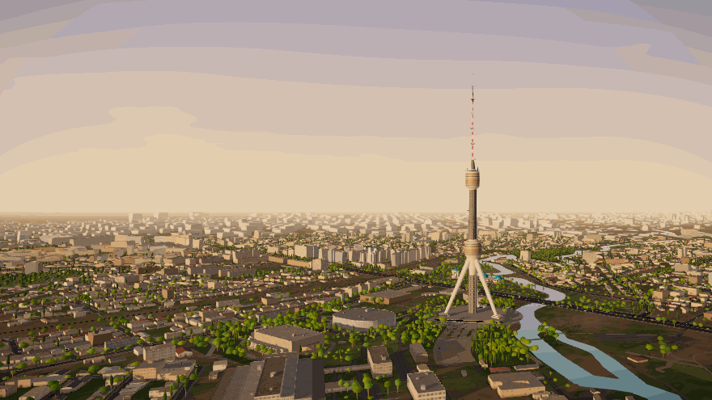
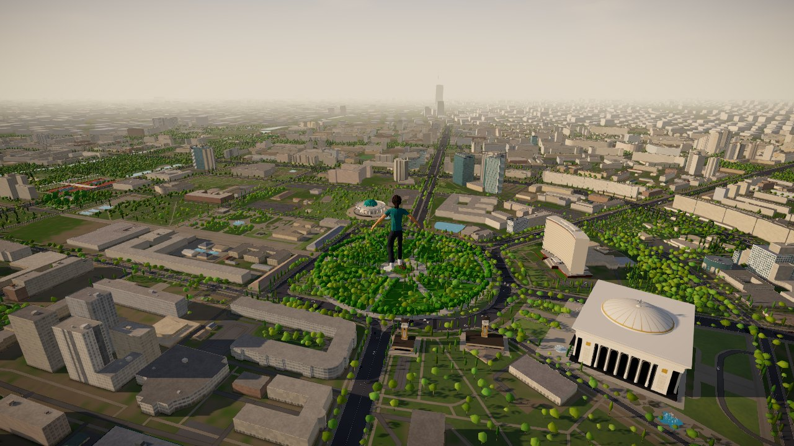
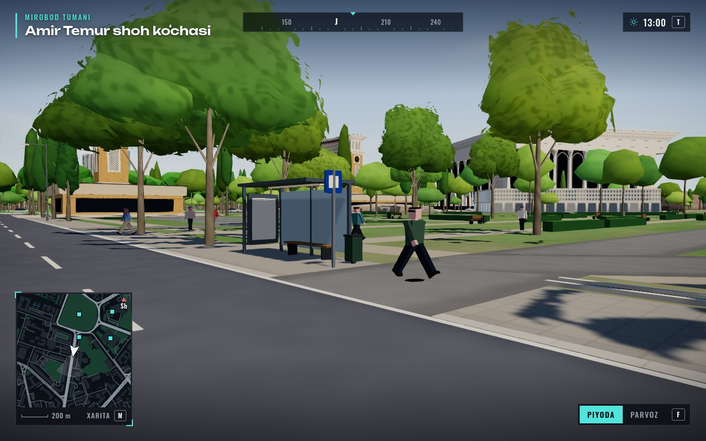
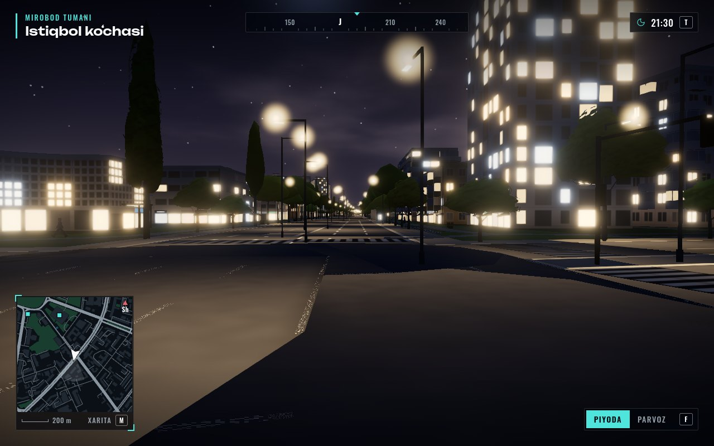
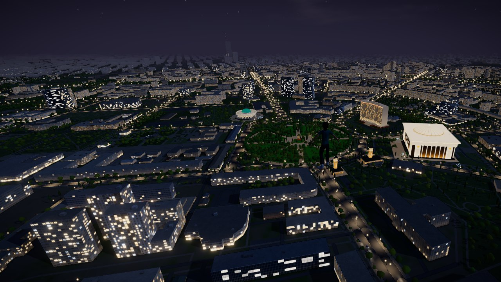
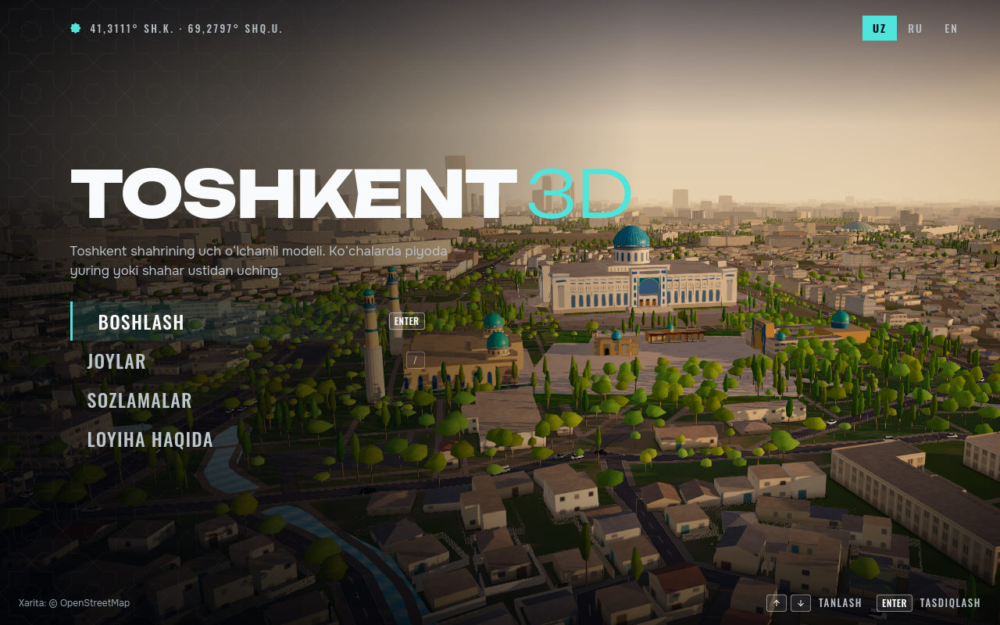
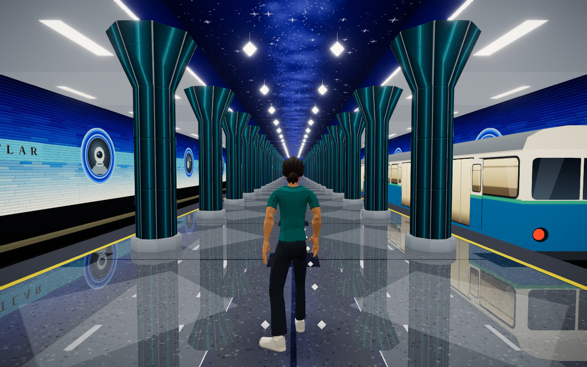
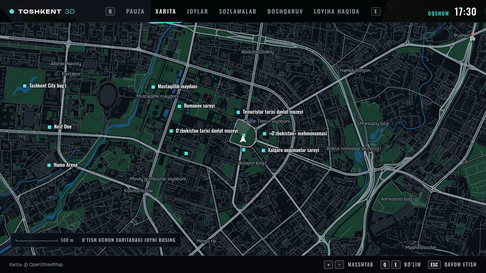
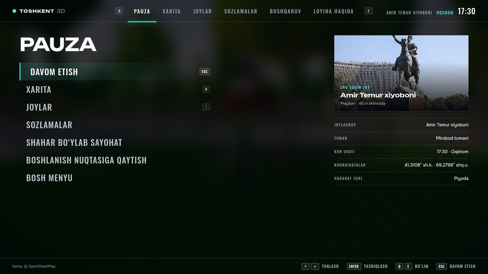
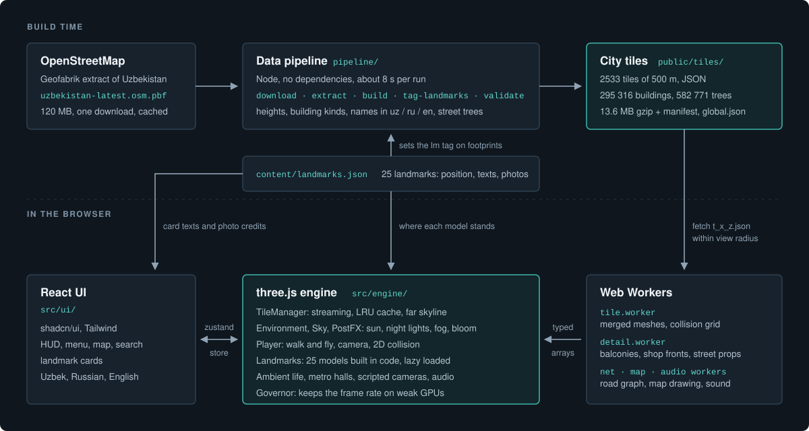

<p align="center">
  <a href="README.md">English</a> · <b>Oʻzbekcha</b> · <a href="README.ru.md">Русский</a>
</p>

<h1 align="center">Toshkent 3D</h1>

<p align="center">
  Butun Toshkent shahrining brauzerda ishlaydigan uch oʻlchamli modeli. OpenStreetMap maʼlumotlari asosida qurilgan.<br>
  Koʻchalarda piyoda yuring yoki shahar ustidan uching.
</p>

<p align="center">
  <a href="https://tashkent-3d.ulussolutions.uz/"><b>Demoni ochish</b></a>
</p>

<p align="center">
  <a href="https://tashkent-3d.ulussolutions.uz/"></a>
  <a href="LICENSE"></a>
  <a href="#litsenziyalar"></a>
</p>

<p align="center">
  <a href="https://tashkent-3d.ulussolutions.uz/">
    
  </a>
</p>

## Bu nima

Toshkent 3D — Toshkentni uch oʻlchamda chizadigan veb-sahifa. Barcha binolarning konturi,
koʻchalar, kanallar va bogʻlar OpenStreetMap maʼlumotlaridan olingan. Yigirma beshta mashhur joy kodda
qoʻlda modellashtirilgan. Shaharda uchinchi shaxs koʻrinishida, piyoda yoki havoda harakat
qilasiz. Bu ochiq dunyoli oʻyinlardagi harakatga oʻxshaydi.

Hech narsa oʻrnatish shart emas, roʻyxatdan oʻtish ham kerak emas. Demo uchun WebGL 2 ni
qoʻllab-quvvatlaydigan brauzer kerak. Loyiha avvalo kompyuter va noutbuk uchun moʻljallangan.
Telefonda ekrandagi boshqaruv ishlaydi.

Loyihaning maqsadi — Toshkentni aylanib koʻrish va uning joylarini tanish. Bu oʻyin emas: unda
vazifa ham, ochko ham yoʻq.

## Skrinshotlar

<table>
  <tr>
    <td width="50%"></td>
    <td width="50%"></td>
  </tr>
  <tr>
    <td align="center">Amir Temur xiyoboni ustida parvoz rejimi.</td>
    <td align="center">Piyoda rejimi: kompas, soat va kichik xarita.</td>
  </tr>
  <tr>
    <td></td>
    <td></td>
  </tr>
  <tr>
    <td align="center">Tun: derazalar va koʻcha chiroqlari.</td>
    <td align="center">Tungi shahar markazi.</td>
  </tr>
  <tr>
    <td></td>
    <td></td>
  </tr>
  <tr>
    <td align="center">Boshlangʻich ekran ortida Hazrati Imom majmuasi.</td>
    <td align="center">Metro bekati zali.</td>
  </tr>
  <tr>
    <td></td>
    <td></td>
  </tr>
  <tr>
    <td align="center">Shahar xaritasi. Oʻtish uchun xaritadagi joyni bosing.</td>
    <td align="center">Menyu.</td>
  </tr>
</table>

## Imkoniyatlar

**Shahar**

- Maʼmuriy chegara ichidagi butun shahar: 609,6 km², har biri 500 m boʻlgan 2533 ta tayl.
- OpenStreetMap konturlaridan koʻtarilgan 295 316 ta bino. Balandlik OSM teglarida boʻlsa,
  oʻsha yerdan olinadi. Boʻlmasa, hujjatlashtirilgan qoidalar boʻyicha baholanadi
  ([Cheklovlar](#cheklovlar) boʻlimiga qarang).
- 8665 km yoʻl: chiziqlar, bordyurlar, trotuarlar va piyodalar oʻtish joylari bilan. 1741 km
  piyodalar yoʻlkasi.
- 582 771 ta daraxt: xaritada belgilangan daraxtlar, shoh koʻchalar boʻylab qatorlar va bogʻlar.
- Kanallar, hovuzlar, bogʻlar va maydonlar. Maydonlarda favvoralar ishlaydi.
- Sheyderda chizilgan oʻnta fasad uslubi: mahalla uylari, sovet davri panelli uylari, shisha
  minoralar, doʻkon peshtoqlari va boshqalar. Derazalar tekstura ham, geometriya ham emas.
- Koʻcha nomlari oʻzbek, rus va ingliz tillarida. OSMda tarjima boʻlmasa, nom transliteratsiya
  qilinadi, tur soʻzi esa tarjima qilinadi (`koʻchasi` → `улица` / `Street`).

**Diqqatga sazovor joylar**

- 25 ta joy qoʻlda modellashtirilgan. Ular orasida teleminora, Hazrati Imom majmuasi, Chorsu
  bozori, Koʻkaldosh madrasasi, Minor masjidi, «Oʻzbekiston» mehmonxonasi, Alisher Navoiy
  teatri, Amir Temur xiyoboni va Nest One bor. Toʻliq roʻyxat:
  [`content/landmarks.json`](content/landmarks.json).
- Har bir joyning kartochkasi bor: qisqa matn, faktlar va Wikimedia Commons saytidan olingan
  fotosuratlar. Har bir fotosurat yonida muallif va litsenziya koʻrsatiladi.
- Shahar boʻylab sayohatda kamera bir joydan ikkinchisiga uchib oʻtadi.

**Shahar hayoti**

- Yoʻl tarmogʻida yengil mashinalar, mikroavtobuslar va avtobuslar yuradi. Trotuar va
  yoʻlkalarda piyodalar yuradi.
- Bogʻlar va maydonlar ustida qushlar uchadi.
- Ovoz brauzerning oʻzida sintez qilinadi: transport shovqini, qushlar, tunda chigirtkalar,
  shamol, qadam tovushi. Repozitoriyda birorta ham audio fayl yoʻq.

**Kun va tun**

- Toʻliq sutkalik sikl: quyosh, oy, yulduzlar va bulutlar. Soatni oʻzingiz belgilang yoki
  vaqtni yurgizib qoʻying.
- Tunda derazalar, koʻcha chiroqlari, doʻkon yozuvlari va faralar yonadi.

**Metro**

- Shaharda barcha 49 ta bekatning kirish joyi bor. Platformaga tushish uchun kirish joyi yonida
  <kbd>G</kbd> tugmasini bosing.
- Uchta zal haqiqiy bekatlar asosida modellashtirilgan: Kosmonavtlar, Alisher Navoiy va
  Mustaqillik maydoni. Qolgan bekatlar shu uch zaldan boshqa ranglarda foydalanadi.
- Poyezdlar keladi, eshiklarini ochadi va joʻnab ketadi.

**Interfeys**

- Oʻzbek (lotin), rus va ingliz tillari.
- Shahar xaritasi, joylarni qidirish, kun vaqtini boshqarish, foto rejimi.
- Klaviatura va sichqoncha. Telefonlarda ekrandagi boshqaruv. Menyuda geympad ishlaydi.

**Unumdorlik**

- Oʻrnatilgan grafika uchun yozilgan. Ishlab chiqishda moʻljal qilingan qurilma — Intel UHD 730.
- Uchta sifat darajasi. Kadr tezligi tushganda avtomatik boshqaruvchi avval render
  oʻlchamini pasaytiradi.
- Toʻliq koʻrinish 100 dan 270 gacha chizish chaqirugʻidan iborat: har bir tayl va material
  uchun bitta birlashtirilgan toʻr.
- Tayllar kamera atrofida yuklanadi va ortda qolganda xotiradan chiqariladi. Uzoqdagi shahar
  instanslangan qutilar bilan chiziladi.
- Shahar maʼlumotlari gzip holatida jami 13,6 MB. Faqat yaqiningizdagi tayllar yuklab olinadi.

## Boshqaruv

| Tugma | Piyoda | Parvozda |
|---|---|---|
| <kbd>W</kbd> <kbd>A</kbd> <kbd>S</kbd> <kbd>D</kbd> | Yurish | Uchish |
| Sichqoncha | Atrofga qarash | Atrofga qarash |
| <kbd>Shift</kbd> | Yugurish | Tezlashish |
| <kbd>Space</kbd> | Sakrash | Yuqoriga (<kbd>E</kbd> ham) |
| <kbd>C</kbd> / <kbd>Q</kbd> / <kbd>Ctrl</kbd> | | Pastga |
| <kbd>F</kbd> | Havoga koʻtarilish | Qoʻnish |
| <kbd>V</kbd> | Birinchi shaxs koʻrinishi | Personajsiz kamera |
| Sichqoncha gʻildirakchasi | Kamera masofasi | Kamera masofasi |
| <kbd>E</kbd> | Yaqindagi joy kartochkasini ochish | |
| <kbd>G</kbd> | Metroga kirish yoki chiqish | |

| Tugma | Istalgan rejimda |
|---|---|
| <kbd>M</kbd> | Xarita |
| <kbd>/</kbd> | Joylar va qidiruv |
| <kbd>T</kbd> | Kun vaqti |
| <kbd>P</kbd> | Foto rejimi (interfeysni yashiradi) |
| <kbd>N</kbd> | Ovozni yoqish yoki oʻchirish |
| <kbd>Esc</kbd> | Menyu |

## Qanday ishlaydi

<p align="center">
  
</p>

1. **Maʼlumotlar konveyeri** ([`pipeline/`](pipeline/README.md)). Node skripti Geofabrik saytidan
   Oʻzbekiston boʻyicha koʻchirmani (120 MB) yuklab oladi va PBF faylni oʻzining kichik parseri
   bilan oʻqiydi. U Toshkent ichidagi obyektlarni qoldiradi, binolarga balandlik va tur
   belgilaydi, nomlarni tozalaydi va tarjima qiladi, koʻchalar boʻylab daraxt joylaydi va har
   bir 500 m li tayl uchun bitta JSON fayl yozadi. npm bogʻliqliklari yoʻq. Koʻchirma yuklab
   olingan boʻlsa, toʻliq ishga tushirish taxminan 8 soniya oladi.
2. **Tayllar** (`public/tiles/`). Koordinatalar — tayl burchagiga nisbatan detsimetrdagi butun
   sonlar. Mahalliy toʻrning boshlanish nuqtasi — Amir Temur xiyoboni. Format
   [`docs/BRIEF.md`](docs/BRIEF.md) faylining «City data contract» boʻlimida tasvirlangan.
3. **Veb-vorkerlar**. Vorker har bir taylni yuklaydi, konturlarni earcut yordamida
   uchburchaklarga boʻladi va har bir material uchun bitta birlashtirilgan toʻr hamda
   toʻqnashuv toʻrini quradi. Boshqa vorkerlar koʻcha detallari, transport uchun yoʻl grafi,
   xarita va ovoz kliplarini tayyorlaydi.
4. **Dvigatel** ([`src/engine/`](docs/ENGINE.md)). Oddiy three.js sinflari, react-three-fiber
   ishlatilmaydi. Dvigatel tayllarni kamera atrofida yuklaydi, osmon va yoritishni chizadi,
   oʻyinchini harakatlantiradi va atrof-muhit tizimlarini yuritadi. Yurishda bino konturlari
   bilan toʻqnashuv ikki oʻlchamda tekshiriladi. Fizika kutubxonasi yoʻq.
5. **Interfeys** (`src/ui/`). React, shadcn/ui va Tailwind. Interfeys va dvigatel faqat bitta
   zustand omborxonasi orqali bogʻlanadi.

Qoʻlda yasalgan modellar alohida chanklarda turadi. Kamera yaqinlashganda brauzer kerakli
modelni yuklab oladi.

## Oʻz kompyuteringizda ishga tushirish

Node.js 22 yoki undan yangi versiya va npm kerak. Maʼlumotlar konveyeriga taxminan 1,1 GB boʻsh
xotira kerak.

```bash
git clone https://github.com/diy0r/tashkent-3d.git
cd tashkent-3d
npm install

# Shahar tayllarini qurish (bir marta 120 MB OpenStreetMap maʼlumotini yuklab oladi)
npm run build-data

# Dev-serverni http://127.0.0.1:5190 manzilida ishga tushirish
npm run dev
```

Yaratilgan tayllar (taxminan 50 MB) repozitoriyda yoʻq. `npm run build-data` buyrugʻini
oʻtkazib yuborsangiz, dvigatel `public/tiles-dev/` papkasidagi kichik sunʼiy shahardan
foydalanadi. Interfeys ustida ishlash uchun shu yetarli.

Production yigʻish va server:

```bash
npm run build:prod   # vite build, soʻng matnli fayllarning gzip va brotli nusxalari
npm run serve        # 8090-portdagi statik server (PORT va HOST orqali oʻzgartiriladi)
```

`server/serve.mjs` faylining bogʻliqliklari yoʻq. U `dist/` papkasini oldindan siqilgan fayllar
va kesh sarlavhalari bilan tarqatadi. Istalgan statik xosting ham mos keladi.

Boshqa buyruqlar:

| Buyruq | Vazifasi |
|---|---|
| `npm run typecheck` | TypeScript turlarini tekshirish |
| `npm run build` | Turlarni tekshirish va yigʻish |
| `npm run tag-landmarks` | `content/landmarks.json` oʻzgargandan keyin joylarni konturlarga qayta bogʻlash |
| `npm run fixture` | `public/tiles-dev/` papkasidagi sunʼiy tayllarni qayta yaratish |
| `cd pipeline && npm run validate` | Tayllarni maʼlumotlar shartnomasi boʻyicha tekshirish |

Foydali URL parametrlari: `?q=low|medium|high` sifatni belgilaydi, `?t=21.5` boshlangʻich
soatni belgilaydi, `?lang=uz|ru|en` tilni belgilaydi, `?perf=1` profaylerni koʻrsatadi,
`?data=dev` sunʼiy tayllarni yoqadi.

## Loyiha tuzilishi

```
content/landmarks.json   joylarning koordinatalari, uch tildagi matnlar, fotosurat mualliflari
pipeline/                OpenStreetMap maʼlumotlarini yuklab olish va qayta ishlash (Node, oʻz package.json)
public/
  tiles/                 yaratilgan shahar tayllari (gitda yoʻq)
  tiles-dev/             ishlab chiqish uchun kichik sunʼiy tayllar toʻplami
  places/                joylarning fotosuratlari
  models/                oʻyinchi personaji
  fonts/                 interfeys shriftlari
src/
  engine/                three.js dvigateli
    world/               tayllarni yuklash, tayl vorkeri, materiallar, daraxtlar, shahar silueti, toʻqnashuvlar
    env/                 quyosh, osmon, tuman, postprotsessing
    player/              yurish va parvoz, kamera, personaj, kiritish
    landmarks/           har bir joy modeli uchun bitta fayl
    ambient/             transport, piyodalar, qushlar, favvoralar
    detail/, props/      balkonlar, doʻkon peshtoqlari, oʻrindiqlar, bekatlar
    metro/               bekat zallari va poyezdlar
    cinematic/           boshlangʻich ekran kamerasi, shahar boʻylab sayohat, foto rejimi
    audio/               sintez qilingan ovoz
    perf/                profayler, obyektlarni kechiktirib koʻrsatish, kadr tezligi boshqaruvchisi
  ui/                    React interfeysi: HUD, menyu, xarita, joy kartochkalari
  state/store.ts         dvigatel va interfeys uchun umumiy zustand omborxonasi
  i18n/                  uz.json, ru.json, en.json
server/serve.mjs         production uchun statik server
tools/                   skrinshot, oʻlchov va yigʻish skriptlari
docs/                    dvigatel haqida qaydlar, dizayn tizimi, tadqiqotlar, manbalar roʻyxati
```

## Yangi joy qoʻshish

1. [`content/landmarks.json`](content/landmarks.json) fayliga yozuv qoʻshing: `id`, `category`,
   `lat`, `lon`, `rotationDeg`, OSMdagi kontur identifikatorlari (`osmIds`, masalan
   `"way/325125766"`), shuningdek oʻzbek, rus va ingliz tillarida `name`, `short`, `text` va
   `facts`.
2. Fotosuratlarni `public/places/<id>/` papkasiga joylang. Faqat erkin litsenziyali
   fotosuratlardan foydalaning. Fayl, manba, muallif va litsenziyani yozuvga hamda
   [`docs/CREDITS.md`](docs/CREDITS.md) fayliga yozing. Kichik rasm yasash uchun
   `python3 tools/thumbs.py` buyrugʻini ishga tushiring (Pillow kerak).
3. `src/engine/landmarks/<id>.ts` faylini yarating. Fayl nomi id bilan bir xil boʻlishi shart.
   Shu `id` va `THREE.Group` qaytaradigan `build()` funksiyasi bor obyektni eksport qiling:
   oʻlchov metrda, y oʻqi yuqoriga, koordinata boshi joyning yerdagi nuqtasida, old tomoni
   shimolga qaragan. Model avtomatik roʻyxatga olinadi.
4. `npm run tag-landmarks` buyrugʻini ishga tushiring. U OSM konturlarini belgilaydi. Shundan
   keyin dvigatel koʻtarilgan qutilarni yashiradi va oʻrniga sizning modelingizni qoʻyadi.
5. Modelni alohida koʻring: `http://127.0.0.1:5190/landmark-preview.html?id=<id>`. Soʻng uni
   shaharda koʻring.

Modellar yengil boʻlsin: birlashtirilgan geometriya, kam material, 1024 px dan katta tekstura
ishlatilmaydi. Batafsil: [`docs/ENGINE.md`](docs/ENGINE.md) va
[`CONTRIBUTING.md`](CONTRIBUTING.md).

## Cheklovlar

- OSMda binolarning atigi 0,9 foizida `height` tegi, 8,4 foizida `building:levels` tegi bor.
  Qolgan balandliklar bino turi, kontur maydoni va qoʻshni binolar boʻyicha baholangan. Baʼzi
  minoralarning balandligi notoʻgʻri.
- Eski shaharning baʼzi mahallalari OSMda toʻliq chizilmagan, shu sababli ayrim kvartallar
  siyrak koʻrinadi.
- Yer tekis. Koʻpriklar yer sathida chizilgan.
- Mashinalar svetoforga qaramaydi va yoʻl bermaydi. Baʼzi bir tomonlama koʻchalarda ular ikki
  tomonga yuradi.
- Unumdorlik koʻp turdagi qurilmalarda oʻlchanmagan. Shahar sekin ishlasa, sozlamalarda sifatni
  pasaytiring yoki sahifani `?q=low` bilan oching.

Notoʻgʻri bino yoki koʻchani tuzatishning eng yaxshi yoʻli — uni
[OpenStreetMap](https://www.openstreetmap.org/) xaritasida tuzatish. Tuzatish maʼlumotlarning keyingi
yigʻilishida paydo boʻladi.

<a name="litsenziyalar"></a>

## Maʼlumotlar va litsenziyalar

| Nima | Litsenziya | Manba |
|---|---|---|
| Dastur kodi | [MIT](LICENSE) | shu repozitoriy |
| Shahar maʼlumotlari: binolar, yoʻllar, suv, yashil hududlar, nomlar | [ODbL 1.0](https://opendatacommons.org/licenses/odbl/1-0/) | © [OpenStreetMap](https://www.openstreetmap.org/copyright) ishtirokchilari, koʻchirma — [Geofabrik](https://download.geofabrik.de/asia/uzbekistan.html) |
| `public/places/` papkasidagi fotosuratlar | CC BY-SA 4.0, CC BY 4.0 yoki CC0, har bir fotosurat uchun alohida | Wikimedia Commons. Har bir fayl muallifi va litsenziyasi bilan [`docs/CREDITS.md`](docs/CREDITS.md) faylida keltirilgan |
| Oʻyinchi personaji `public/models/character.glb` | CC0 1.0 | [Quaternius](https://quaternius.com) |
| Shriftlar: Unbounded, Oswald, Onest | SIL Open Font License 1.1 | Google Fonts |
| `content/landmarks.json` faylidagi joy matnlari | MIT, kod bilan bir xil | shu loyiha uchun yozilgan |

MIT litsenziyasi faqat kodga tegishli. Konveyer yaratadigan tayllar OpenStreetMap asosidagi
hosila maʼlumotlar bazasi hisoblanadi va ODbL ostida qoladi. Ularni yoki ular asosida qurilgan
narsani eʼlon qilsangiz, «© OpenStreetMap ishtirokchilari» deb koʻrsating va hosila
maʼlumotlarni shu litsenziya ostida ochiq qoldiring. Ilova bu yozuvni boshlangʻich ekranda va
menyuda koʻrsatadi.

CC BY va CC BY-SA litsenziyali fotosuratlardan qayta foydalanilganda muallif va litsenziya
koʻrsatilishi shart.

## Minnatdorchilik

- Toshkentni binoma-bino xaritaga tushirgan [OpenStreetMap](https://www.openstreetmap.org/)
  ishtirokchilariga va kundalik koʻchirmalar uchun [Geofabrik](https://www.geofabrik.de/) xizmatiga.
- [three.js](https://threejs.org/), [postprocessing](https://github.com/pmndrs/postprocessing),
  [earcut](https://github.com/mapbox/earcut), [zustand](https://github.com/pmndrs/zustand),
  [React](https://react.dev/), [shadcn/ui](https://ui.shadcn.com/),
  [Tailwind CSS](https://tailwindcss.com/), [Vite](https://vite.dev/) va
  [Lucide](https://lucide.dev/) loyihalariga.
- Suratlari joy kartochkalarida turgan Wikimedia Commons fotograflariga.
- CC0 litsenziyali personaj modeli uchun [Quaternius](https://quaternius.com) muallifiga.

## Loyiha qanday yaratilgan

Kod, joylarning modellari va matnlarni dasturlash uchun moʻljallangan sunʼiy intellekt agentlari
(Anthropic kompaniyasining Claude modeli) yozgan. Muallif maqsadlarni belgilagan, ishni
yoʻnaltirgan va natijalarni tekshirgan. Kartochkalardagi faktlar Vikipediya va Wikidata bilan
solishtirilgan, ammo xatolar boʻlishi mumkin. Xato topsangiz, issue oching.

## Hissa qoʻshish

Xatolar haqidagi xabarlar, tuzatishlar va yangi joylar mamnuniyat bilan qabul qilinadi.
[`CONTRIBUTING.md`](CONTRIBUTING.md) fayliga qarang (ingliz tilida).
